# 🎓 Smart Face Recognition-Based Attendance System

[](https://www.python.org/)
[](https://flask.palletsprojects.com/)
[](https://opencv.org/)
[](https://github.com/ageitgey/face_recognition)
[](https://www.sqlite.org/)

An automated, contactless, real-time attendance management solution powered by Computer Vision and Deep Learning. The system allows seamless student/employee registration, instant face encoding using 128-dimensional facial embeddings, and live in-browser attendance logging with check-in and check-out tracking.

---

## 📌 Table of Contents

- [Key Features](#-key-features)
- [System Architecture & Workflow](#-system-architecture--workflow)
- [Tech Stack](#-tech-stack)
- [Project Structure](#-project-structure)
- [Prerequisites & Installation](#-prerequisites--installation)
- [How to Run](#-how-to-run)
- [User Guide](#-user-guide)
- [API & Route Reference](#-api--route-reference)
- [Database Schema](#-database-schema)
- [Troubleshooting & FAQs](#-troubleshooting--faqs)
- [License](#-license)

---

## ✨ Key Features

- **In-Browser Webcam Integration (HTML5 WebRTC)**: Live video feed rendered directly in the web browser, eliminating reliance on blocking desktop GUI windows.
- **Fast 128-d Face Embeddings**: Powered by state-of-the-art dlib ResNet models (`dlib_face_recognition_resnet_model_v1`) for accurate facial verification under various lighting angles.
- **Single-Click Student Registration**: Capture face snapshots directly through the browser webcam or upload a clear photo from the local device.
- **Automated Live Attendance Scanner**: Continuous real-time scanning with immediate visual feedback, highlighting recognized individuals on screen.
- **Dual Timestamping (Time-In & Time-Out)**: Automatically registers the first scan of the day as `attendance_in` and subsequent scans as `attendance_out`.
- **Duplicate Prevention**: Prevents redundant check-in records for the same individual on the same calendar day.
- **Date-Wise Records Filtering**: Comprehensive tabular logs viewable and filterable by date, complete with one-click data purge option.

---

## 🔄 System Architecture & Workflow

```mermaid
flowchart TD
    subgraph Registration ["1. Student Registration"]
        A[User opens /register] --> B[HTML5 Camera Preview]
        B --> C[Capture Snapshot / Upload Photo]
        C --> D[Extract 128-d Face Encodings]
        D --> E[(Save Metadata & Encodings to known_faces.csv)]
    end

    subgraph Attendance ["2. Live Attendance Marking"]
        F[User opens /attendance] --> G[Live Browser Scanner Feed]
        G --> H[Capture Frame & Send to /api/mark_attendance]
        H --> I[Face Detection & Metric Comparison]
        I -->|Match Found| J{Existing Record Today?}
        J -->|No| K[Log attendance_in in SQLite]
        J -->|Yes, No Time-Out| L[Update attendance_out in SQLite]
        J -->|Already Checked Out| M[Log Confirmed]
        K --> N[Render Live Success Card]
        L --> N
    end

    subgraph Records ["3. Attendance Records"]
        O[Open /records] --> P[View All Logs or Filter by Date]
    end
```



---

## 🛠 Tech Stack

| Component | Technology | Description |
| :--- | :--- | :--- |
| **Backend** | Python 3, Flask | Lightweight WSGI web framework & RESTful routing |
| **Computer Vision** | OpenCV (`cv2`) | Video frame capture, image resizing, and color transformations |
| **Face Recognition** | `face_recognition` (dlib) | Deep-learning face detection and 128-dimensional vector encoding |
| **Database** | SQLite3 (`attendance.db`) | Relational storage for attendance records and timestamps |
| **Encodings Store** | CSV (`known_faces.csv`) | Persistent repository for student metadata & face vectors |
| **Frontend** | HTML5, CSS3, JavaScript | Responsive user interface with WebRTC Camera API & Canvas |

---

## 📂 Project Structure

```plaintext
Face-Recognition-Based-Attendance-System/
│
├── app.py                                   # Core Flask application, routes, and recognition logic
├── attendance.db                            # SQLite database storing attendance records
├── known_faces.csv                          # Stored student metadata and 128-d facial encodings
├── dlib_face_recognition_resnet_model_v1.dat # Pretrained ResNet model for facial embeddings
├── requirements.txt                         # Python dependencies
├── README.md                                # Project documentation
│
└── templates/                               # HTML5 web templates
    ├── index.html                           # Landing page & navigation dashboard
    ├── register.html                        # Student registration with live camera & photo upload
    ├── take_attendance.html                 # Live automated attendance scanning interface
    └── attendance.html                      # Attendance records table with date filter & clear options
```

---

## 🚀 Prerequisites & Installation

### 1. Prerequisites
- **Python**: Version `3.9` through `3.13` installed on your machine.
- **C++ Build Tools / CMake** (Required by `dlib` if compiling from source):
  - **Windows**: Install [CMake](https://cmake.org/download/) and Visual Studio C++ Build Tools.
  - **Linux (Ubuntu/Debian)**: `sudo apt-get install build-essential cmake libopenblas-dev liblapack-dev`
  - **macOS**: `brew install cmake`

### 2. Clone the Repository
```bash
git clone https://github.com/your-username/Face-Recognition-Based-Attendance-System.git
cd Face-Recognition-Based-Attendance-System
```

### 3. Set Up Virtual Environment (Recommended)
```bash
# Windows
python -m venv venv
venv\Scripts\activate

# macOS / Linux
python3 -m venv venv
source venv/bin/activate
```

### 4. Install Dependencies
```bash
pip install -r requirements.txt
```

---

## 💻 How to Run

1. Start the Flask application:
   ```bash
   python app.py
   ```
2. Open your preferred web browser (Google Chrome, Microsoft Edge, or Mozilla Firefox) and navigate to:
   ```text
   http://127.0.0.1:5000
   ```
3. Grant camera permissions when prompted by your browser to enable real-time scanning.

---

## 📖 User Guide

### 1. Register a Student (`/register`)
1. Click **Register Student** from the homepage or navigate to `/register`.
2. Allow browser camera access. A live camera preview box will display your face.
3. Fill in the student information:
   - **Full Name**
   - **USN / Roll Number**
   - **Branch** (e.g., Computer Science)
   - **Semester**
   - **Email Address**
   - **Residential Address**
4. Click **Capture & Register**. The system will detect your facial features, generate the 128-d vector, and store it.
   > **Note**: If your camera is being used by another application, toggle *"Or choose a photo from your computer"* to upload an image directly.

### 2. Take Attendance (`/attendance`)
1. Click **Take Attendance** from the dashboard.
2. The browser will open the **Automated Attendance Scanner**.
3. Position registered individuals in front of the camera.
4. As soon as a registered face is recognized, a green notification card appears in the **Live Attendance Log** confirming check-in or check-out.

### 3. View & Filter Attendance Records (`/records`)
1. From the homepage, select a specific date or navigate directly to `/records`.
2. View records containing Name, USN, Branch, Semester, Date, Time In, and Time Out.
3. Use the **Clear All Attendance** button if you need to reset the attendance log.

---

## 🔌 API & Route Reference

| Method | Endpoint | Description |
| :--- | :--- | :--- |
| `GET` | `/` | Home dashboard with quick action links |
| `GET` | `/register` | Student registration form with live camera preview |
| `POST` | `/register` | Process student metadata and face encodings (base64 or file upload) |
| `GET` | `/attendance` | Live in-browser attendance scanning interface |
| `POST` | `/api/mark_attendance` | JSON API receiving video frames, performing matching, and recording attendance |
| `GET` | `/records` | View all attendance records with optional `?date=YYYY-MM-DD` query filter |
| `POST` | `/clear_attendance` | Purges all records in `attendance.db` |

---

## 🗄 Database Schema

The SQLite database (`attendance.db`) utilizes the following structure:

```sql
CREATE TABLE attendance (
    name            TEXT,       -- Student Full Name
    usn             TEXT,       -- University Seat Number / ID
    branch          TEXT,       -- Academic Department / Branch
    semester        TEXT,       -- Current Semester
    email           TEXT,       -- Student Email
    address         TEXT,       -- Student Address
    date            TEXT,       -- YYYY-MM-DD
    attendance_in   TEXT,       -- First scan timestamp (HH:MM:SS)
    attendance_out  TEXT        -- Subsequent scan timestamp (HH:MM:SS)
);
```

---

## ❓ Troubleshooting & FAQs

<details>
<summary><b>1. Browser says "Camera permission denied" or video is blank</b></summary>
Ensure your browser has permission to access your webcam:
- In Chrome / Edge: Click the 🔒 lock icon in the URL address bar and set <b>Camera</b> to <b>Allow</b>.
- Verify that no other software (such as Zoom, Microsoft Teams, or Skype) has an exclusive lock on your camera.
</details>

<details>
<summary><b>2. "No face detected in the picture" error during registration</b></summary>
- Ensure adequate lighting on your face without strong backlighting or shadows.
- Look directly into the camera lens.
- Avoid accessories covering major facial features (heavy sunglasses, masks).
</details>

<details>
<summary><b>3. How do I change the recognition threshold/tolerance?</b></summary>
In <code>app.py</code> inside <code>api_mark_attendance()</code>, adjust the <code>tolerance</code> parameter in <code>compare_faces</code>:
<pre><code>matches = face_recognition.compare_faces(known_encodings, encoding, tolerance=0.5)</code></pre>
- Lower tolerance (e.g., <code>0.45</code>): Stricter matching (fewer false positives).
- Higher tolerance (e.g., <code>0.55</code>): More lenient matching (better for varying lighting conditions).
</details>

---

## 📄 License

This project is licensed under the [MIT License](LICENSE) — free for educational and commercial use.
